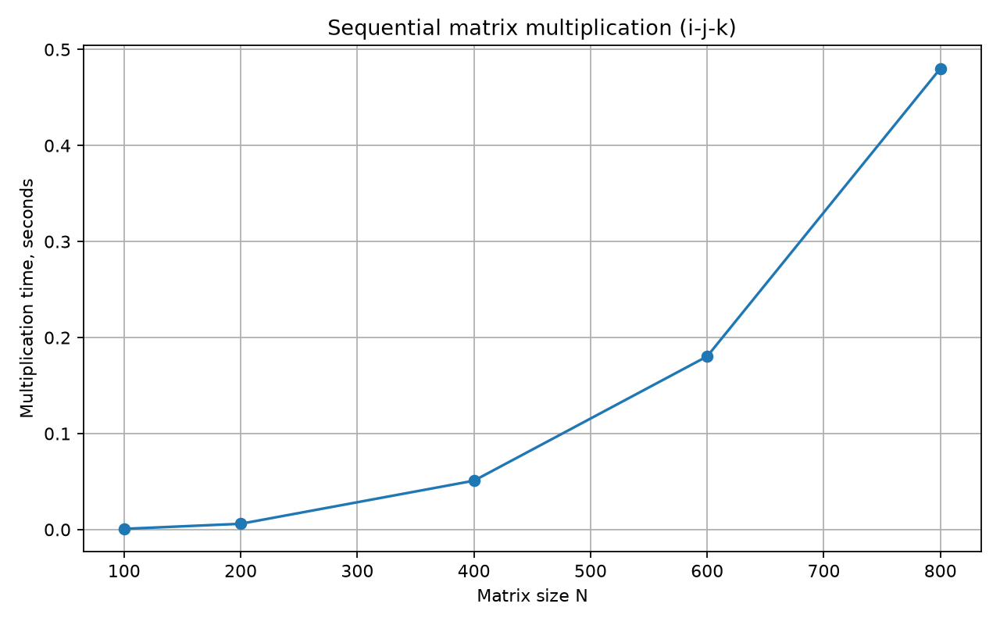

# Лабораторная работа №1
## Последовательное умножение квадратных матриц

**Курс:** Параллельное программирование  
**Выполнил:** Викторов Дмитрий Алексеевич
**Группа:** 6214-100503D

---

## 1. Задание

Разработать программу на C++, которая читает две квадратные матрицы из файлов,
вычисляет их произведение и сохраняет результирующую матрицу, время выполнения
и объём вычислений. Проверить корректность результата с помощью Python и NumPy.
Провести эксперименты с разными размерами матриц.

## 2. Реализация — мой алгоритм

- **C++17** и `std::vector<std::vector<double>>` для хранения матриц.
- `ReadMatrix()` читает исходные данные из `input/inputA.txt` и `input/inputB.txt`.
- `operator*()` реализует **последовательное** умножение тремя циклами **`i-j-k`**.
- `std::chrono::steady_clock` измеряет время операции `C = A * B`.
- `WriteResults()` создаёт папку `output` и записывает матрицу и сведения об опыте.
- `verify.py` проверяет результат с помощью `NumPy` (оператор `@`).

### Фрагмент моего умножения

```cpp
for (std::size_t i = 0; i < rows1; ++i) {
    for (std::size_t j = 0; j < cols2; ++j) {
        for (std::size_t k = 0; k < cols1; ++k) {
            C[i][j] += matrix1[i][k] * matrix2[k][j];
        }
    }
}
```

Каждый элемент `C[i][j]` — сумма произведений элементов строки матрицы A
и столбца матрицы B. Для квадратных матриц размера `N × N` выполняется
`N³` умножений и `N³` прибавлений к накопителю (включая прибавление к нулю).
Теоретическая сложность — **O(N³)**.

## 3. Структура проекта

```text
Lab1/
├── main.cpp                 — мой C++ код
├── generate.py              — случайные матрицы; можно указать размер
├── verify.py                — проверка NumPy
├── experiments.py           — серия экспериментов, таблица и график
├── input/
│   ├── inputA.txt           — матрица A (создаёт generate.py)
│   └── inputB.txt           — матрица B (создаёт generate.py)
├── output/
│   ├── outputC.txt          — произведение матриц (создаёт C++)
│   ├── info.txt             — размер, число операций, время (создаёт C++)
│   └── graph.png            — график времени умножения
└── README.md
```

### Один обычный запуск со случайным размером

```powershell
py generate.py
.\program.exe
py verify.py
```

### Один запуск с заданным размером (например 200 × 200)

```powershell
py generate.py 200
.\program.exe
py verify.py
```

Без аргумента `generate.py` случайно выбирает `N` от 2 до 1000.
Числа внутри матриц тоже случайные: целые и дробные в диапазоне от −5 до 5.

## 4. Верификация

`verify.py` независимо выполняет `expected = A @ B` с помощью NumPy.
При правильном результате выводится `PASS`, при неправильном — `FAIL`
и ненулевой код завершения.

## 6. Результаты контрольного запуска

| N | N² | N³ | Умножение, с | Весь запуск, с | Проверка |
|---:|---:|---:|---:|---:|:---:|
| 100 | 10000 | 1000000 | 0.000725300 | 0.073542300 | PASS |
| 200 | 40000 | 8000000 | 0.005999300 | 0.280964400 | PASS |
| 400 | 160000 | 64000000 | 0.050886900 | 1.039299800 | PASS |
| 600 | 360000 | 216000000 | 0.180380100 | 2.378268800 | PASS |
| 800 | 640000 | 512000000 | 0.480245500 | 4.403427600 | PASS |

«Время умножения» — результат `std::chrono::steady_clock` только вокруг
`C = A * B`. «Полный запуск» — время процесса C++ с открытием и записью
файлов, измеренное Python с `time.perf_counter()`; **без** генерации
матриц и проверки NumPy.

## 7. График



## 8. Выводы

1. Последовательное умножение квадратных матриц имеет трудоёмкость **O(N³)**.
2. Для контрольных размеров 100–800 независимая проверка NumPy завершилась
   успешно (`PASS` во всех пяти опытах).
3. Время умножения возрастает с размером матрицы. Для отчёта нужно использовать
   замеры, выполненные на той машине, на которой проводятся эксперименты.
